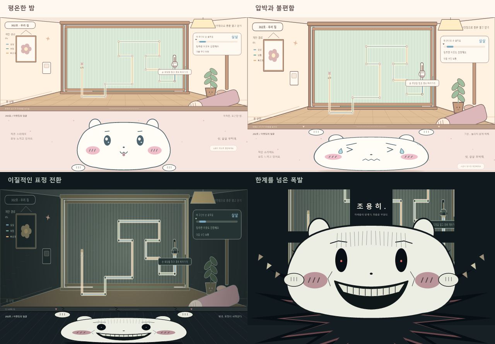

# 문 좀 살살

원룸 중문을 조심히 여닫아 아랫집의 인내심을 지키는 마우스 게임 시안입니다. 최신 버전은 **SVG로 그린 2D 게임**이며, 귀여운 화면이 소음에 따라 급격하게 공포스러운 분위기로 바뀝니다.



## 실행

Node.js 20 이상에서 실행합니다. 추가 패키지 설치는 필요하지 않습니다.

```sh
npm start
```

브라우저에서 `http://127.0.0.1:5173/`을 엽니다. 파일로 실행하려면 `dist/2d/index.html`을 직접 열거나, `npm run standalone`으로 생성한 `build/quiet-door.html`을 엽니다.

## 조작과 규칙

- 위 화면의 손 모양을 누른 채 복잡한 경로를 따라 움직입니다. 이동량에 맞춰 중문이 열리고 닫힙니다.
- 구간별로 **살살 / 보통 / 빠르게** 요구 속도가 바뀝니다. 경로를 벗어나거나 속도를 맞추지 못하면 소음이 발생합니다.
- 아래 화면은 아랫집 캐릭터의 얼굴 클로즈업입니다. 소음이 쌓이면 위 화면이 내려오며 얼굴을 프레스처럼 누릅니다.
- 표정은 평온 → 불편 → 고통 순으로 변하다가, 인내심이 일정 수준을 넘으면 검은 눈과 기묘한 미소로 급변합니다. 화면 색감과 소리도 동시에 바뀝니다.
- 조작을 멈추면 소음과 압박이 풀립니다. 최종 한계에 도달하면 캐릭터가 폭발하며 위 화면을 부수고 게임이 끝납니다.
- 열기 → 닫기 → 열기 → 닫기, 네 번의 조작을 완료하면 성공합니다.
- **표정 변화** 버튼은 변화와 진정을, **폭발 연출** 버튼은 화면 파괴까지 자동으로 보여줍니다.
- 연습 모드는 폭발 후 계속 진행할 수 있습니다. `Esc`로 일시정지하고 소리·재시작 버튼을 사용할 수 있습니다.

기본 테마는 귀여운 버전입니다. 상단에서 코믹·호러 테마도 선택할 수 있습니다. 소리는 시작 버튼 등 사용자 입력 이후 활성화되며 진행 정보는 서버로 전송하지 않습니다.

## 검증

```sh
npm run check
npm test
```

경로 건너뛰기 방지, 구간별 속도, 압박에 맞춘 마우스 좌표 변환, 공포 전환과 진정, 폭발 타임라인, 연습·시연 모드, 네 경로 완주, SVG 렌더링 및 화면 제어를 검증합니다.

## 파일 구성

- `dist/2d/`: 최신 SVG 2D 버전. `core.js`는 게임 상태, `paths.js`는 경로 판정, `portrait.js`는 얼굴·프레스·파괴 연출, `art.js`는 방과 중문을 그립니다.
- `dist/previous-3d.html`: 초기 3D 시안. 아래 화면에서 아랫집의 일상과 현관 접근을 보여줍니다.
- `scripts/`: 정적 서버, 문법 확인, 단일 HTML 생성 도구.
- `tests/`: 별도 설치 없이 실행하는 Node.js 테스트.
- `docs/`: 초기 기획 정리와 현재 연출 미리보기.

## 사용 라이브러리

최신 2D 버전은 외부 런타임 라이브러리 없이 SVG·CSS·JavaScript와 Web Audio로 동작합니다. 초기 3D 버전은 Three.js r160.1을 사용하며 MIT 라이선스 원문을 `dist/THREE-LICENSE.txt`에 보존했습니다. 캐릭터와 장면은 코드로 그린 벡터 도형입니다.
